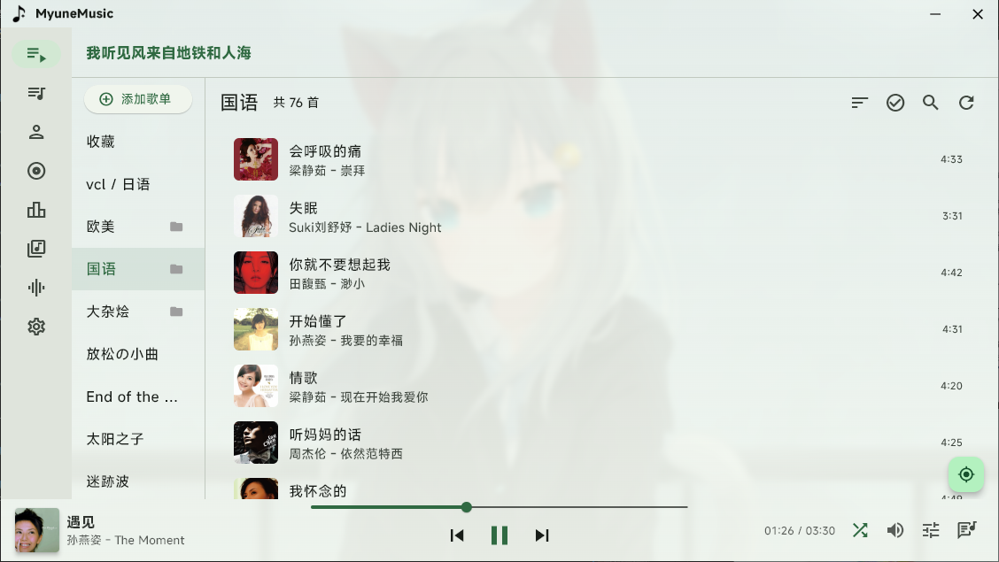
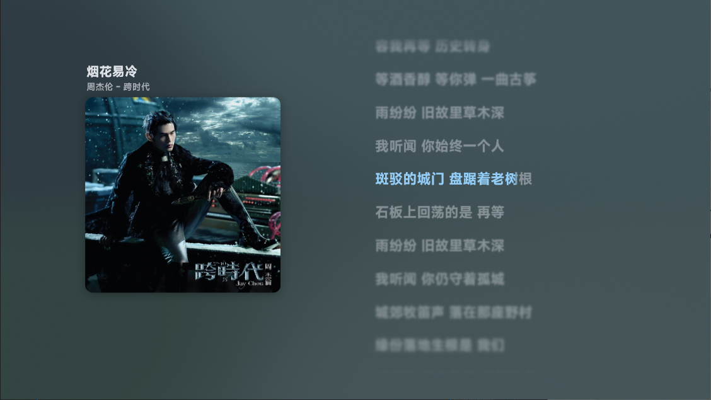
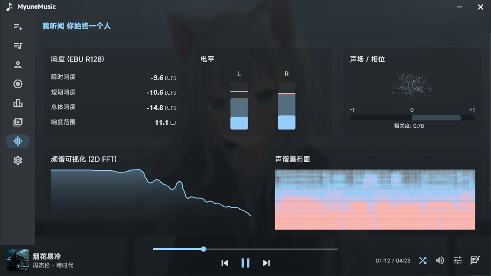

# 🎵 Myune Music

<div align="center">

### 基于 Flutter 构建的跨平台本地音乐播放器

<!-- 技术与协议胶囊徽章 -->
<p align="center">
  <a href="https://flutter.dev/"></a>
  
  
  <a href="LICENSE"></a>
</p>

<!-- Trendshift 趋势荣誉卡片 -->
<p align="center">
  <a href="https://trendshift.io/repositories/18744?utm_source=trendshift-badge&amp;utm_medium=badge&amp;utm_campaign=badge-trendshift-18744" target="_blank" rel="noopener noreferrer"></a>
  &nbsp;&nbsp;
  <a href="https://trendshift.io/repositories/18744?utm_source=repository-badge&amp;utm_medium=badge&amp;utm_campaign=badge-repository-18744" target="_blank" rel="noopener noreferrer"></a>
</p>

</div>

---

## ✨ 特性
* 💻 支持 **Windows / Linux** 双平台
* 🎶 歌曲管理：支持 **文件夹歌单** 与 **手动歌单**
* 🧠 自动按 **歌手** 与 **专辑** 分类
* 🎨 使用 [Material 3](https://m3.material.io/) 组件与配色
* 📝 多种歌词支持：内嵌歌词、本地 `lrc、yrc、qrc、krc 文件`、网络歌词源，支持逐字歌词
* 🔊 提供多种音频滤镜与EQ支持
* ✨ 可自定义主题配色、字体、背景图
* 🧩 支持 **音频独占模式**（仅 Windows）
* ⚙️ **全局快捷键**支持
* 🎵 读取使用和写入 **ReplayGain** 标签
* 🔍 支持模糊搜索拼音搜索与首拼搜索
* 🎤 支持实时音频分析 (该页面默认被隐藏，可在 设置 → 个性化 → 页面可见性设置 手动开启)

## 🔧关于 Linux

对于0.9.1及以下的版本，需要安装 `libmpv`

例如 **Ubuntu/Debian**

``` bash
sudo apt install libmpv-dev mpv 
```

对于0.9.2及以上版本，需要安装 `keybinder-3.0` 以使用全局快捷键

例如 **Ubuntu/Debian**

``` bash
sudo apt install keybinder-3.0
```

如果遇到快捷方式（.desktop）不显示图标的问题 请参考 [issues #114](https://github.com/xiaobaimc/myune_music/issues/114)

## 📸 软件截图


<div align="center">

### 主界面


</div>

<div align="center">

### 播放页面



</div>

<div align="center">

### 音频分析




</div>

> 该页面默认被隐藏，可在 设置 → 个性化 → 页面可见性设置 手动开启
---

## 🎶 桌面歌词
由于 [Flutter](https://flutter.dev/) 暂不支持多窗口功能，因此暂未提供桌面歌词
可使用以下第三方工具替代：

* [Lyricify Lite](https://apps.microsoft.com/detail/9nltpsv395k2)
* [BetterLyrics](https://apps.microsoft.com/detail/9p1wcd1p597r)

> 以上软件非本人开发，请支持原作者 🙏

## 🌐 歌词

### 歌词来源与优先级

软件会按照 **歌词来源优先级** 中的顺序依次尝试获取，默认顺序：

```
内嵌歌词 → 外置 LRC → 外置 KRC → 外置 QRC → 外置 YRC → 网络歌词
```

可在「设置 → 个性化 → 歌词来源优先级」中调整顺序

> 外置歌词文件需与歌曲**同名且位于同一目录**，目前仅支持 **UTF-8** 编码

### 网络歌词

在「设置 → 常规」中启用 **从网络获取歌词** 后，若上述来源均未取到歌词，则自动从网络获取

软件默认提供三个源可供选择，三个源全部支持逐字 + 翻译+ 注音的获取

> 软件默认不会显示注音，如有需要请将```同时间戳歌词行数```设为3或以上

当前选中的源未匹配到歌曲时，会自动使用其他源进行匹配

> 特别感谢 [lyricGeter](https://github.com/WisteriaZy/lyricGeter/) 提供的歌词获取以及处理逻辑

### 歌词解析

假设有如下格式的歌词：

>[02:55.031]照らされた世界 咲き誇る大切な人
>
>[02:55.031]在这阳光普照的世界 骄傲绽放的重要之人
>
>[02:55.031]te ra sa re ta se ka i sa ki ho ko ru ta i se tsu na hi to

三句歌词时间戳相同，软件会识别为同一句歌词的不同行，从上到下依次对应 **原文 / 翻译 / 罗马音**

此时可通过「歌词显示设置 → 同时间戳歌词行数」控制显示行数：例如设为 `2`，最后一行（罗马音）将不再显示

### 逐字歌词

支持两种格式，软件会自动识别，无需手动设置：

>[00:15.237]悴[00:15.742]ん[00:15.908]だ[00:16.200]心

或：

>[00:15.237]<00:15.237>悴<00:15.742>ん<00:15.908>だ

---

## 📦 内嵌元数据支持

| 文件格式     | 元数据格式                     |
|-------------|------------------------------|
| AAC (ADTS)  | `ID3v2`, `ID3v1`             |
| Ape         | `APE`, `ID3v2`, `ID3v1`      |
| AIFF        | `ID3v2`, `Text Chunks`       |
| FLAC        | `Vorbis Comments`, `ID3v2`   |
| MP3         | `ID3v2`, `ID3v1`, `APE`      |
| MP4         | `iTunes-style ilst`          |
| MPC         | `APE`, `ID3v2`, `ID3v1`      |                        
| Opus        | `Vorbis Comments`            |
| Ogg Vorbis  | `Vorbis Comments`            |
| Speex       | `Vorbis Comments`            |
| WAV         | `ID3v2`, `RIFF INFO`         |
| WavPack     | `APE`, `ID3v1`               |

## 🎵 支持的音频格式

底层使用 mpv，依赖 FFmpeg 解码，理论上支持绝大多数音频格式

部分格式需在「设置 → 高级」中启用 **允许添加任何格式的文件** 后方可添加到歌单

> 可参阅 [media-kit 支持格式列表](https://github.com/media-kit/media-kit#supported-formats) 作为参考

---

## ☁️ 网络媒体（WebDAV / FTP / Google Drive）

左侧导航「网络媒体」可以直接挂载 NAS / 网盘上的音乐库，不需要先把文件拷到本地。

### 支持的协议

| 协议 | 说明 |
| --- | --- |
| **WebDAV** | 群晖 WebDAV Server、Nextcloud / ownCloud、坚果云、绿联、极空间等；支持 HTTP / HTTPS 与 Basic 认证 |
| **FTP** | 标准被动模式（PASV）+ 二进制传输；支持匿名与账号密码登录 |
| **Google Drive** | **原生直连**官方 Drive API v3，不经过任何第三方 WebDAV 桥；支持「我的云端硬盘」和共享云端硬盘、快捷方式、HTTP Range 拖动进度 |

> 暂不支持 FTPS / SFTP；FTP 为明文协议，公网使用请改用 WebDAV over HTTPS。
> Google Drive 只会列出可下载的二进制文件，Google 文档 / 表格 / 幻灯片没有音频内容，会自动被音频过滤器排除。

### 使用方式（WebDAV / FTP）

1. 进入「网络媒体」→「添加网络源」，选择 **WebDAV** 或 **FTP**，填写地址、端口、根路径与账号；
2. 点「测试连接」确认可访问后保存；
3. 选中网络源即可浏览目录。列表**只显示文件夹与音频文件**，网盘里的视频、图片、文档不会混进来。

### 使用方式（Google Drive 原生）

登录与文件夹选择全部在应用内完成（授权那一步会临时打开系统浏览器）：

1. 进入「网络媒体」→「添加网络源」，把顶部类型切到 **Google Drive**；
2. 点 **「网页登录 Google 账号」**：系统浏览器打开 Google 授权页 → 登录 → 点「允许」→
   浏览器显示「授权成功」后自动回到应用，`refresh_token` 已经自动填好并存到本机；
3. 点「文件夹 ID」右侧的 **「浏览…」**，在弹出的 Drive 文件夹树里一层层点进去，
   点「使用此文件夹」即可设为默认读取目录（留空表示整个「我的云端硬盘」）；
4. 点「测试连接」→ 显示「根目录有 N 个条目」后保存。

网页登录前需要一对 OAuth 客户端凭据：点「从本机文件导入凭据」可读取
`文档/myune_music/google_drive.json` 里的 `clientId` / `clientSecret`，
或在「手动填写 / 导入凭据（高级）」里直接填。这两个值由你自己在
Google Cloud Console 创建，仓库和程序里**不会内置任何真实凭据**。
仍可沿用旧方式：完全手填三件套 + 文件夹 ID，不经过浏览器。

凭据文件的格式（字段名固定，只放在本机）：

```json
{
  "clientId": "你的 OAuth client_id",
  "clientSecret": "你的 OAuth client_secret",
  "refreshToken": "你的 refresh_token",
  "rootFolderId": "可选的根文件夹 ID"
}
```

> **安全说明**：`refresh_token` 等同于该 Google 账号 Drive 的长期读写权限。它只保存在本机
> `shared_preferences`，不会随程序分发、不会写进日志、不会提交到仓库，也不会出现在任何
> 代码或构建产物里。请勿外发或截图。若怀疑泄露，请到 Google 账号的
> 「安全性 → 第三方应用访问权限」里撤销该授权并重新生成。

> 与「自己搭一个 Google Drive → WebDAV 桥」相比，原生直连少一跳：实测首包在 1 秒内，
> 且 Drive API 本身返回 `206 + Content-Range`，拖动进度不再依赖桥接服务是否正确实现 Range。

### 网页登录（OAuth loopback）说明

网页登录采用 Google 官方为桌面应用推荐的 **Loopback IP address 流程**：

```
本机临时 HTTP 服务 127.0.0.1:53682（占用则顺延到 53693）
   ↓ 用系统浏览器打开 accounts.google.com/o/oauth2/v2/auth
   ↓ 参数：access_type=offline、prompt=consent、state=随机值（防伪造回调）
用户在网页里登录并同意
   ↓ Google 把 code 重定向回 http://127.0.0.1:53682/
   ↓ 校验 state → 用 code + client_id/client_secret 换 token
拿到 access_token + refresh_token → 写入本机设置与 google_drive.json → 关闭临时服务
```

几个需要注意的点：

* **权限范围**：`https://www.googleapis.com/auth/drive`（完整 Drive 读写），这样才能上传、
  新建、重命名与删除。它是 Google 的「受限范围」，未做 OAuth 验证的应用会显示
  「此应用未经验证」，把账号加进该 OAuth 客户端的**测试用户**即可继续。
* **重定向 URI**：客户端类型为「桌面应用」时 Google 允许任意 loopback 端口，无需登记；
  若用的是「Web 应用」类型，需要在 Cloud Console 把
  `http://127.0.0.1:53682/`（以及顺延端口）加入「已获授权的重定向 URI」，
  否则会报 `redirect_uri_mismatch`。界面里的登录说明也写了这一条。
* **凭据不进仓库**：`client_id` / `client_secret` / `refresh_token` 只存在本机
  `shared_preferences` 与 `文档/myune_music/google_drive.json`，不写日志、不随程序分发。
* 登录超时 10 分钟，可随时点进度框「取消」；临时 HTTP 服务在结束时一定会关闭。
* 「更多 → 查看当前 Google 账号 / 授权范围」可以确认当前连的是哪个账号。

### 文件管理（上传 / 新建 / 重命名 / 删除）

写入操作目前只开放给 **Google Drive 源**（WebDAV / FTP 仍为只读浏览）：

| 入口 | 行为 |
| --- | --- |
| 更多 → **上传本地音频到当前目录** | 多选本机音频，串行上传到当前目录；按 4 MB（256 KB 整数倍）分块 resumable PUT，带实时进度与「取消」，不会把大文件整首读进内存 |
| 更多 → **在当前目录新建文件夹** | 输入名称后创建，创建完自动刷新列表 |
| 文件 / 文件夹行尾 ⋮ → **重命名** | 调 `files.update`（PATCH）改名 |
| 文件 / 文件夹行尾 ⋮ → **移入回收站** | 调 `files.delete`，**不是永久删除**，可在 Google Drive 网页端「回收站」恢复；删除前有二次确认 |
| 选文件夹弹窗 → **新建文件夹** | 在浏览目录树时直接建新文件夹，立刻可作为默认读取目录 |

上传用的是 Drive API v3 的 `uploadType=resumable`：先 POST metadata 拿到会话 URL，
再按块 PUT 并带 `Content-Range: bytes start-end/total`，中间返回 `308 Resume Incomplete`，
最后一块返回 `200/201` 即完成。文件选择器只放行常见音频扩展名，
避免把视频 / 文档误传进音乐库。

### 播放与队列

* 单击文件立即播放；行尾按钮可「立即播放」或「加入播放队列」；
* 顶部「播放全部」把当前目录的音频一次性加入播放队列，不用逐首点；
* 「更多 → 递归扫描并播放 / 递归扫描并加入队列」会把**所有子目录**里的音频一次性收集起来（默认上限 5000 首、8 层深度），适合「歌手/专辑」多层目录的曲库；
* 「更多 → 点击行为」可切换单击是「立即播放」还是「加入队列」。

### 加入歌单 / 全部歌曲

网络媒体的音频和本地文件一样可以进歌单，重启后不会丢：

* 「更多 → 全部加入歌单…」或单曲行尾「⋮ → 加入歌单…」：弹窗选一个已有歌单；
* 「更多 → 全部加入「全部歌曲」」或单曲行尾「⋮ → 加入「全部歌曲」」：自动落到内置的
  **「网络媒体收藏」**歌单。因为「全部歌曲」是由所有歌单聚合出来的虚拟列表，本身没有可追加的
  存储，所以用这个真实落盘的容器歌单承载，加进去之后左侧歌单和「全部歌曲」里都能看到；
* 「更多 → 递归扫描并加入歌单 / 递归扫描并加入「全部歌曲」」：一次把整棵目录树存进去。

### 标签 / 封面 / 歌词（预加载）

网盘上的音频没有本地路径，所以按需用 HTTP `Range` 拉文件头来解析标签：

* **滚动到哪读到哪**：列表行可见时才去读标签，不会一进歌单就把整个曲库全拉一遍；
  不需要先播放一次——列表渲染出来就会在后台读；
* **结果落盘，重启不重读**：读到的标题 / 歌手 / 专辑 / 时长 / 内嵌歌词 / 封面会写入
  `文档/myune_music/tag_cache/`（元数据 JSON 与封面二进制分开存），下次启动先载入索引，
  列表直接命中缓存，不会为同一首歌反复请求 2 MB 文件头。缓存 key 是
  「网络源 id + 媒体 id / 远端路径」，代理端口在 18765-18774 之间变化也不会失效；
  上限 3000 条 / 512 MB，超出按最久未修改淘汰，删掉该目录即等于清空缓存；
* **只拉文件头**：先取 2 MB。MP3 的 ID3v2、FLAC 的元数据块、M4A 的 moov 都在文件开头，
  一次请求就能拿到标题 / 歌手 / 专辑 / 内嵌封面 / 内嵌歌词 / 精确时长；
  实测 59 MB 的 FLAC 全部标签只占前 537 KB，封面 527 KB、内嵌歌词 1 KB 都在其中；
* **双解析路径**：FLAC（`METADATA_BLOCK` / `VORBIS_COMMENT` / `PICTURE`）与 MP3（ID3v2 的
  APIC / USLT / TIT2 等帧）由纯 Dart 直接从字节解析，不依赖文件扩展名、不要求文件完整；
  M4A / OGG / APE 等由 Rust lofty 解析同一个带真实扩展名的头部文件。两条路径结果按
  「字节解析优先」合并，任一成功即可；
* **一键读取**：「更多 → 一键读取本目录封面」会把当前目录所有音频的封面 / 标题 / 时长 /
  歌词一次读完并落盘（默认 2 并发、只拉文件头），适合进入新目录后先把封面铺满；
* 头部完全解析不出东西时才退回完整下载（单文件上限 96 MB，足以覆盖 80 MB 以上的无损文件）；
* 读到之后标题、歌手、时长、封面会**就地回填**到列表、「正在播放」的播放页背景和
  系统媒体会话；封面就绪晚于歌词加载时，内嵌歌词也会补上（不抢走已显示的在线歌词）；
* **可核对**：每次成功都会在 `文档/myune_music/logs/network.log` 写一行
  `tag read ok ... cover=527186B lyrics=1058ch duration=287272ms`，
  用「更多 → 查看网络日志」即可确认某首歌到底读没读到封面和歌词；
* **内嵌歌词优先**：播放时先读文件内嵌的 LRC，读不到再走原来的在线歌词（酷狗 / 网易 / QQ），
  在线歌词的行为与原版完全一致；
* 读不到标签时不会反复重试，也不会覆盖成「无标签」，避免一次上游 502 把结果记死；
* 缓存目录 `<系统临时目录>/myune_net_cache` 有 400 MB 上限，超出按最久未修改自动清理；
* 不想要这部分流量可以在「设置 → 高级 → 读取网络媒体内嵌标签」关掉，关掉后只用文件名和网盘
  目录封面。

### 实现说明

* **不落盘**：远端文件不会被缓存到本地，播放时由本机流代理（`127.0.0.1:18765-18774`）按需拉流，边下边播；
* **支持拖动进度**：代理实现了 HTTP Range（`200` / `206` + `Content-Range`），并在上游忽略 Range 时自行跳过起始字节，避免拖动后 `loading failed`；
* **元数据与封面**：优先读文件内嵌标签；读不到时标题/歌手从「歌手 - 标题」命名自动拆分，封面回退到目录内的 `cover.jpg` / `folder.jpg` / `albumart.png` 等文件，并写入播放队列持久化，重启后仍显示；
* **失败可诊断**：上游请求失败会自动重试 3 次，并把每次请求写进
  `文档/myune_music/logs/network.log`；`NetworkMediaService.diagnose()` 能直接区分「上游拒绝 / 太慢 /
  不支持 Range」和「本机代理异常」；
* **队列可恢复**：代理端口若被占用会顺延，播放前会按原 token 改写为当前端口，历史队列不会失效；
* **Google Drive 链路**：`refresh_token → access_token`（只在内存缓存、提前 2 分钟过期、并发刷新合并）
  → `files.list` 分页列目录（`supportsAllDrives` / `includeItemsFromAllDrives` 覆盖共享盘，
  并解析 `shortcutDetails` 快捷方式）→ `files.get?alt=media` 流式下载，带 `Range: bytes=a-b`
  时上游直接返回 `206`；总长度还能用 `files.get?fields=size` 兜底补全；
* **协议判定以配置为准**：代理 URL 里的 `proto` 只作元数据，实际用哪个客户端一律以
  `RemoteSource.type` 为准，避免旧队列里的别名把 Drive 请求错发到 WebDAV / FTP 端口；
* 网络源配置（含密码与 Google 凭据）只保存在本机 `shared_preferences`，不会写进日志。

---

## 🔧 网络媒体标签 / 封面修复说明（本轮改动记录）

> 适用提交链：`7967e32` → `77fcff0` → `2348302` → `6b4b363`（`feat/webdav-ftp-network-drive`），均已推送至远端并在 GitHub Actions 编译通过。

### 问题现象

之前版本对网盘上的 FLAC / MP3 音频无法读取内嵌专辑封面和内嵌歌词，播放页左侧只显示模糊背景但无实际封面图；右侧系统媒体控件却往往有封面——因为系统侧通过另一条链路拿到了 artwork，应用内 `currentSong.albumArt` 却始终为空。

查看 `文档/myune_music/logs/network.log` 能找到确切报错：

```
tag parse failed (... .head): No format could be determined from the provided file
tag parse failed (... .bin): No format could be determined from the provided file
```

### 根因

旧实现在 `_fetchHead()` 把 HTTP Range 拉下来的前 2MB 字节存成 `<hash>.head`，完整兜底下载存成 `<hash>.bin`。**两个文件名都没有任何扩展名或正确识别用的后缀**。Rust 侧的 `lofty` 接到这种"裸"临时文件时，既无法从路径推断格式，也因为没有完整的音频帧导致 probe 失败，于是报出上面那行错误——等于什么都没读到就放弃了。

### 改动链（按时间顺序）

| commit | 消息 | 职责 |
| --- | --- | --- |
| `7967e32` | `fix(network): 修复网络媒体内嵌封面/歌词读取并回填播放页` | 新增纯 Dart 头部标签解析器 + 双路径合并逻辑 + 播放页回填链路（最大一批，+639 行） |
| `77fcff0` | `style(network): 消除 2 条非空断言告警并修正标签 partial 语义` | 修掉上一版遗留的 2 条 `unnecessary_non_null_assertion` lint 警告，并把 `partial` 语义改成「仅当两条解析路都失败才算 partial」 |
| `2348302` | `feat(network): 标签/封面缓存落盘，重启后不再重复拉取文件头` | 把已读到的元数据 JSON 与封面二进制写进磁盘缓存，启动时自动索引；同时修掉 Stream.whereType / FileStat 数值的编译错误 |
| `6b4b363` | `fix(network): 修复缓存落盘编译错误，新增「一键读取本目录封面」` | 补上遗漏的错误处理 + 给网络媒体页加「一键读取本目录封面」菜单入口 |

合计 8 个文件，净增约 +1041 / −53 行。

### 涉及文件与关键代码位置

#### 1. `lib/services/network/network_header_tags.dart`（**新文件**，407 行）
纯 Dart 从头字节解析器，不依赖扩展名、不要求文件完整。

关键类：
- `NetworkHeaderTags`（第 14–50 行）：标签载体，含 `title` / `artist` / `album` / `lyrics` / `cover` / `durationMs` / `trackNumber` / `format` 字段。
- `NetworkHeaderTagParser.parse(bytes)`（第 57 行）：入口点；按 magic 分派到 `_parseFlac` / `_parseId3`。

支持的格式与帧映射：

| 容器 | 解析的块/帧 | 对应字段 |
| --- | --- | --- |
| FLAC `fLaC` 开头 | `STREAMINFO`（type 0）+ `VORBIS_COMMENT`（type 4）+ `PICTURE`（type 4 / JPEG/PNG） | 时长 / 标题歌手专辑歌词 / 封面 |
| MP3 ID3v2 | v2.2 / v2.3 / v2.4；帧 TIT2/TT2、TPE1/TP1、TALB/TAL、TCON/TCO、TRCK/TRK、USLT/ULT、APIC/PIC | 同左 |
| M4A / OGG / APE | **不走这里**，由 lofty 兜底 | — |

辅助函数集中在文件下半段（第 290–406 行）：
- `_u24be` / `_u32be` / `_u32le` / `_syncSafe`：大端 / 小端 / syncsafe 无符号整数解码
- `_id3Text` / `_id3Lyrics` / `_id3Picture`：ID3 文本帧、 lyrics 帧、图片帧的结构化抽取
- `_ascii(bytes, offset, len)`：定长 ASCII 比较（用于 magic 检测）

#### 2. `lib/services/network/network_tag_reader.dart`（主体改动，+466 / −6 行）
这是整个改动的总调度器。

重要 API 与变更：

| 方法 / 字段 | 所在行（HEAD） | 作用 |
| --- | --- | --- |
| `class NetworkTagInfo` | ~50 行 | 对外暴露的标签模型（序列化支持由这个类承载） |
| `class NetworkTagReader` | ~117 行 | 核心单例服务 |
| `static Future<void> initialize()` | ~135 行 | 启动时扫描 `tagCacheDir` 重建内存索引（JSON 条目加载到 `_cache`） |
| `static Future<NetworkTagInfo?> read(url)` | ~193 行 | 主读取接口：内存命中 → 磁盘命中 → 联网 2MB 文件头 → 兜底完整下载；任一成功即写入磁盘 |
| `static NetworkTagInfo? cached(String url)` | 新增同步 getter | 列表渲染时用，零成本取内存或磁盘快照 |
| `static void prefetch(String url)` | ~217 行 | 预热用（不等待结果），被「一键读取」触发 |
| `static Future<int> prefetchAll(Iterable<String> urls)` | ~229 行 | 批量预热返回已完成数量，就是「一键读取」走的路径 |
| `_fetchHead(url, headerBytes: 2*1024*1024)` | ~271 行 | 发起 HTTP Range 请求并把头字节以带正确扩展名的 `<hash>_head.<ext>` 写入缓存临时目录；同时返回 `Uint8List` 供字节解析 |
| `_readUncached(url)` | ~324 行 | 核心解析：先 `NetworkHeaderTagParser.parse(head.bytes)`，再 try lofty，两者合并返回；写 `network.log` 形如 `tag read ok ext=.flac ... via=flac cover=...B lyrics=...ch duration=...ms` |
| `_combine(headerTags, loftyInfo)` | ~370 行 | 「字节解析优先」合并策略：封面 / 歌词 / 标题均优先用字节解析的结果 |
| `_remember(url, info)` | ~420 行 | 写内存 + 写磁盘：`.json`（元数据）+ `.cover`（封面二进制）到 `<Documents>/myune_music/tag_cache/<hash>.{json,cover}` |
| `_diskCacheKey(url)` | ~579 行 | **关键点**：从 `RemoteMediaRegistry.decodeTarget(url)['i']`（源 id）+ `['p']` / `['t']`（远端路径）合成 stable key，不含代理端口，所以端口漂移不影响缓存命中 |
| `_tagCacheDir()` / `_netCacheDir()` | ~641 行 | 缓存根目录：磁盘走 `<Documents>/myune_music/tag_cache/`（3000 条目 / 512 MB 上限，LRU 淘汰）；临时文件头走 `<temp>/myune_net_cache/`（400 MB 上限） |

#### 3. `lib/page/playlist/playlist_content_notifier.dart`（+66 / −6 行）
封面 / 歌词回填播放页与系统媒体会话的驱动层。

关键改动：
- `_refreshNetworkSongTags(url)`（~1330 行附近）：改为**统一调 `NetworkTagReader.read(url)`**（内部走 内存→磁盘→网络三级），替换原来的 `cached() ?? await read()` 短路写法，避免「内存里没有但磁盘有」时被跳过导致封面补不上。
- `_prepareSongForPlayback(song)`（~1195 行附近）：网络分支同步合并缓存标签，确保首次打开播放页就能看到封面。
- `_onNetworkTagReady(url, info)`：标签就绪回调中增加当前歌曲检查，若匹配的 Song 还没封面就把封面缓存写到 `_coverStore`。
- `lyrics_handler.refreshEmbeddedLyrics(songFilePath)`：延迟的歌词填充——如果歌曲播放开始时在线歌词已经显示，内嵌歌词不会抢走它；等内嵌歌词就绪后再补上。

#### 4. `lib/lyrics/lyrics_handler.dart`（+22 行）
新增 `refreshEmbeddedLyrics(String songFilePath)` 方法，供播放引擎在标签落盘后通知歌词组件刷新。

#### 5. `lib/main.dart`（+5 行）
`main()` 末尾加一行：

```dart
await NetworkTagReader.initialize();
```

放在 `NetworkMediaService.initialize()` 之后。作用：App 冷启动时把磁盘 tag cache 索引一次性载入内存 Map，后续「滚动到哪读到哪」在缓存命中时直接返回，不触发任何网络请求。

#### 6. `lib/page/network/network_media_page.dart`（+94 行）
新增菜单项与批量读取 UI。

- 右上角 ⋮ 菜单新增：`「一键读取本目录封面」`
- `_prefetchCurrentDirectory()` 私有方法：拿到 `_audioEntries`、确认代理可用后调 `NetworkTagReader.prefetchAll(urls)`，期间弹出 `AlertDialog` 展示 `ValueListenableBuilder<int>(valueListenable: progress)` 实时进度（"已处理 N / total"），完成给出 toast 提示；点对话框任意处不会中断后台任务。
- 并发控制：默认 2 并发（`_prefetchCurrentDirectory` 里串行化调用 `prefetch()`，由 `NetworkTagReader._inflight` map 做并发合并）。

### 数据流（一句话概括）

```
[列表渲染 / 播放点击]
        ↓
PlaylistContentNotifier._prepareSongForPlayback()
        ↓
NetworkTagReader.read(url)   ←───┐ 内存命中？直接返回       │
        ↓                        │                           │
    磁盘命中？(tag_cache/*.json) │  是 → 反序列化 -> 回填    │
        ↓                        │                           │
    _fetchHead(url, bytes=2MB)  │  否 → ┌───────────────────┘
        ↓                        │     │
_networkHeaderTagParser.parse()│     ▼
  (FLAC STREAMINFO/VORBIS/PICTURE
   或 ID3 TIT2/USLT/APIC 等)      │
        ↓ 字节解析成功？           │
   YES → 写磁盘 → 返回            │
   NO  → 调 lofty(带真实扩展名的
         头部临时文件)             │
              ↓                   │
         字节解析 || lofty 成功？  │
              ↓                   │
          YES → 写磁盘 → 返回     │
          NO  → 完整下载 96MB 兜底 │
                                 │
回填：currentSong.albumArt        │
      _coverStore.put(...)        │
      setMediaSession(...)        │
      lyricsHandler.refreshEmbeddedLyrics(...)
```

### 用户可观察的现象

1. **成功日志**：`文档/myune_music/logs/network.log` 中出现形如
   ```
   tag read ok ext=.flac head=2097152B total=61990968B via=flac cover=527186B lyrics=1058ch duration=287272ms
   ```
   `via=flac` 表示纯字节解析成功，`via=lofty` 表示走了 Rust 兜底；`cover=0B` / `lyrics=0ch` 表示该格式没有对应的内嵌标签。

2. **失败日志**：仍以 `tag parse failed ... No format could be determined from the provided file` 出现，意味着连兜底的完整下载也没能认出格式（极少见，可能是加密 / 损坏音频）。

3. **缓存目录**：`<Documents>/myune_music/tag_cache/` 下的文件：
   - `<hash>.json` —— UTF-8 JSON，包含 title / artist / album / genre / trackNumber / durationMs / lyrics
   - `<hash>.cover` —— 原始封面图字节（JPEG / PNG），base64 编码后存储在内存，写入数据库 / session 时用这个二进制文件
   删掉整个 `tag_cache/` 目录即等同于清空全部缓存，下次进入网络目录会重新拉一次文件头。

4. **「一键读取」按钮**：打开一个音频目录后点击右上角 ⋮，选择「一键读取本目录封面」；进度弹窗会实时显示「已处理 N / total」；可点「后台继续」让对话框不阻塞其它操作。

### 性能与存储影响

- **单次读取**：2 MB Range 请求实际下载约 2 MB 网络流量 + 几毫秒本地解析；大多数 FLAC / MP3 都能在其中命中。
- **封面落盘**：每张封面约 50-600 KB，3000 首上限理论占用约 1.5 GB，但 512 MB 软上限会自动 LRU 淘汰最久未访问的条目。
- **启动代价**：`initialize()` 分批并发（每批 8 个）读取 `tag_cache` 里的 JSON **和 `.cover` 二进制**，128 MB 以内会在启动阶段全部补回内存；本机 102 首 / 38 MB 实测为纯本地 IO，不产生任何网络请求。超过 128 MB 的部分仍走按需读取。

### 已知限制

- 目前只实现 FLAC 与 ID3v2（MP3）两种格式的头部解析；M4A / OGG / APE 仍依赖 lofty，如果它们的元数据区落在 2MB 之外的情况下可能读不到——这种情况建议关掉「设置 → 高级 → 读取网络媒体内嵌标签」回退到纯文件名模式，避免每次都走完整下载的慢路径。
- `tag_cache` 是进程级索引 + 磁盘文件的组合；强制断电 / 崩溃可能导致个别条目半写（json 已写 cover 未写），下次启动时 JSON 里取不到封面字段会自动重读——不会破坏已有数据。
- 「一键读取」在当前实现下是 2 并发，对于几百首的大目录可能需要十几秒到几十秒不等，建议在 WiFi 环境下使用。

### 如何验证本轮改动是否生效

跑最新版 Windows 包（`release/myune_music_windows_x64_cover_lyrics.zip` 之后的任意版本），进入你的 Google Drive / WebDAV 的某个音频目录：

1. 首次进入：等列表加载，封面应该陆续在每行出现；
2. 退出 App，重新启动，回到同一目录：封面**瞬间全部出现**，无需任何点击；
3. 点右上角 ⋮ →「一键读取本目录封面」：应出现进度弹窗，完成后列表全部铺满；
4. 打开「更多 → 查看网络日志」，翻到底部找 `tag read ok` 行，确认 `via=` 字段不是空的、`cover=` 和 `duration=` 都有数值；
5. 播放其中一首歌，左侧播放页应能看到专辑封面模糊背景、顶部进度条旁显示内嵌歌词。

以上任一条不符合预期，请把 `network.log` 的最后 50 行（`tail -n 50 <path>/logs/network.log`）贴出来以便定位。

> 注：上面第 2 条在 `6b4b363` / `ac03d98` 版本里**实际不成立**，是本次修复要解决的问题，详见下一节。

## 🔁 启动后封面不自动显示（必须手动点「一键读取」）修复记录

### 问题现象

用户实测反馈：**每次刚进软件，所有网络媒体的封面都是空白；必须手动点一次「一键读取本目录封面」（重新读一遍缓存），封面才会全部出现**。点完之后当前会话一直正常，但重启又回到空白。

### 根因（两个缺陷叠加）

1. **磁盘封面没有在启动时补回内存索引**
   `NetworkTagReader.initialize()` 只扫描 `tag_cache/*.json` 并重建 `_diskIndex`。而 `NetworkTagInfo.toJson()` 刻意不序列化 `cover`（封面单独存 `<hash>.cover` 二进制文件，避免 JSON 被几百 KB 图片撑爆）。于是重启后 `_diskIndex` 里的条目恒为 `hasCover == false`，`cached()` 同步返回的信息里没有封面。
   同一次运行内点「一键读取」会走 `_remember()` → `_saveToDisk()`，后者执行 `_diskIndex[hash] = info`（**这里的 info 是带封面的**），所以当前会话立刻正常 —— 这正是「点一次就好、重启又坏」的原因。

2. **路径归一化把网络代理 URL 破坏了**
   `PlaylistContentNotifier._normalizePath()` 直接 `return p.normalize(path);`。Windows 上 `package:path` 的 `normalize()` 会把 `http://127.0.0.1:18765/myune/<token>` 里的连续斜杠折叠并转成反斜杠，结果不再是合法 URL。
   而封面工作线程 `_coverWorker()` 里是 `final filePath = cacheKey;`，拿到的是这个被破坏的字符串：
   - `RemoteMediaRegistry.isNetwork(filePath)` → `isProxyUrl()` 要求 `startsWith('http://127.0.0.1:')` → 判定为 **false**；
   - 于是走「本地文件 `readAudioInfo()`」分支，对一个不存在的路径读标签，必然失败；
   - 结果 `_coverlessPaths.add(cacheKey)`，这一行被标记为「已确认无封面」，**连按需补封面也不会再触发**。

   `Song._normalizeForCache()` 早已针对 `'://'` 做了保护（网络地址原样返回），但 `PlaylistContentNotifier._normalizePath()` 没有同步这个修复，两处 key 语义不一致，又连带让 `Song.normalizedPath` 与封面仓库的 key 对不上。

### 本机证据（2026-11-11）

```
Documents/myune_music/tag_cache/ : 102 个 .json + 102 个 .cover ，共 38 MB
network.log:
  19:14~19:15  tag read ok ... cover=xxxxxB ...   ← 上一次「一键读取」写的盘
  19:54:36     tag cache loaded 102 entries        ← 重启，只加载了 JSON
  19:54:36 之后没有任何封面读取记录                ← 封面从未补回内存
```

### 改动文件与关键代码位置

| 文件 | 位置 | 改动 |
| --- | --- | --- |
| `lib/services/network/network_tag_reader.dart` | `NetworkTagInfo.withCover()` | 新增：用 `.cover` 字节补全来自 JSON 的条目，供启动与按需 hydrate 复用 |
| 同上 | `_maxHydratedCoverBytes` | 新增常量 128 MB，限制启动时一次性补回的封面体积 |
| 同上 | `initialize()` | 改为「JSON + `.cover` 一起读」，每批 8 个并发；写日志 `tag cache loaded N entries, covers hydrated M (X.X MB)` |
| 同上 | `_loadDiskEntry(File, bool)` | 新增：单条目读取；`fromJson` 返回 null 但存在 `.cover` 时仍构造一个只有封面的条目，不丢数据 |
| 同上 | `_readCoverByHash(String)` / `_readCoverFile(String)` | 新增按 hash 直读；`_hydrateCover()` 改用 `withCover()` 减少重复 |
| `lib/page/playlist/playlist_content_notifier.dart` | `_normalizePath()` | 网络 URL / `nas:` 标识原样返回，与 `Song._normalizeForCache()` 对齐；本地路径仍 `p.normalize()` |
| 同上 | `_loadAllData()` | 末尾追加 `unawaited(_primeNetworkCoversFromDisk())` |
| 同上 | `_primeNetworkCoversFromDisk()` | 新增：延迟 150 ms 避开 Provider 创建期，`initialize()` 幂等兜底 → `_sweepNetworkTagsIntoSongs()` 回填全部列表 → 更新 `_currentSong` 与其封面 → `notifyListeners()` |
| 同上 | `requestSongCover()` | 新增快速路径：网络媒体若 `NetworkTagReader.cached(key)` 已有封面，直接 `_coverStore.put()` 播种，首帧即可显示，不必等封面工作线程排队 |

### 修复后的数据流

```
启动 main()
  └─ await NetworkTagReader.initialize()
       ├─ 读 <hash>.json        → 标题 / 歌手 / 专辑 / 时长 / 内嵌歌词
       └─ 读 <hash>.cover       → 封面二进制  ← 本次新增
            ↓ _diskIndex[hash] = 带封面的 NetworkTagInfo
  └─ runApp → PlaylistContentNotifier
       ├─ _loadAllData() 末尾 _primeNetworkCoversFromDisk()
       │    └─ _sweepNetworkTagsIntoSongs() → 列表 Song.albumArt + _coverStore
       └─ 列表行 SongCoverBuilder
            ├─ coverCacheKey(原始 URL) → _normalizePath 原样返回 ← 本次修复
            └─ requestSongCover() → cached()?.cover → _coverStore.put() → 立即重绘
```

全程**零网络请求**：封面来自本机 `tag_cache`，仅在播放时才需要本机流代理。

### 如何验证

1. 确认 `tag_cache/` 里有成对的 `.json` + `.cover`；
2. 完全退出 App 再启动，进入「全部歌曲」/ 歌单，**不点任何按钮**，封面应在列表首帧出现；
3. 打开「更多 → 查看网络日志」，应看到一行：
   `tag cache loaded 102 entries, covers hydrated 102 (36.2 MB)`（数字按实际曲库变化）；
4. 播放网络歌曲，播放页模糊背景封面、系统媒体控件封面都应同步出现；
5. 「一键读取本目录封面」仍可用，但对已缓存条目应当秒完成且**不产生 `tag read ok` 联网日志**。

### 已知限制

- 启动时补回封面有 128 MB 软上限；超大曲库超出部分仍会在列表行可见时按需从磁盘读取，不影响正确性。
- 旧版本可能已在内存里把部分路径误标记进 `_coverlessPaths`，但该集合是进程级的，重启即清空；升级到本版本后不会再产生误标记。
- 网络媒体页的**文件列表行**目前仍用文件图标而不是封面缩略图（该页展示的是远端目录项，不是已入库的 Song）。若需要在这一页也显示封面缩略图，属于另一项 UI 改动，本轮未纳入。


## 🛠 网络播放 / 歌曲详情 / 网页登录稳定性修复记录（本轮改动）

### 问题现象

1. 点击播放网络音频时，多数情况下报
   `MpvLogError(prefix: lavf, level: LogLevel.error, text: avformat_open_input() failed)`。
2. 打开「歌曲详情」页，所有网络媒体都显示「无法加载歌曲详情，请稍后重试」。
3. Google Drive 网页登录在低性能电脑上有一定概率失败；失败后进度窗口要等满 5 分钟才能重试。

### 根因（四条，互相独立）

**① 后缀型 Range 被当成文件开头返回（播放报错主因）**

FFmpeg 在 `avformat_open_input()` 探测阶段，为了读 MP3 的 ID3v1 / APE tag 或 MP4 的尾部元数据，
会发 `Range: bytes=-500` 这类「最后 N 字节」请求。旧代理的正则只解析出 `to=500`，
`start` 留空，于是 `formatRangeHeader(null, 500)` 生成 `bytes=0-500`，把**文件开头**返回给播放器，
并谎报成合法 206。libavformat 拿到错位数据就直接放弃，报 `avformat_open_input() failed`。

**② 声明了 Content-Length 却没发够，且 keep-alive 复用了半截响应**

`本机 Documents/myune_music/logs/network.log` 里的证据：

```text
stream done sent=9090     expected=70564705 ⚠ 上游提前结束
stream done sent=1128885  expected=41332587 ⚠ 上游提前结束
stream done sent=725288   expected=26145410 ⚠ 上游提前结束
```

这些小数值既包含「FFmpeg 探测读完就主动断开」，也包含上游 `alt=media` 长连接中途结束。
旧实现只要响应提前结束，就留下一条声明了完整长度、实际却发不够的 HTTP 响应；
默认 keep-alive 又让 mpv 的下一次请求（探测后 seek）复用同一条 TCP 连接，读到错位字节。
`work/probe_playback.py` 用真实凭据实测 Google Drive API 对
`bytes=0-` / `bytes=0-2097151` / `bytes=48401-` / 无 Range 都稳定返回合法 `206/200`、
`Content-Range`、`Content-Length` 与 `fLaC` 首字节，说明**上游 API 正常，问题在本机代理**。

**③ 代理 URL 被当成本地磁盘路径（歌曲详情）**

网络媒体的 `filePath` 是 `http://127.0.0.1:<port>/myune/<base64url>` 或 `nas:` 媒体标识，
不是 Windows 路径。旧 `getCurrentSongDetails()` 无条件调用 `Uri.file()` / `File.exists()` /
Rust `readAudioInfo()`：URL 里的冒号被当成非法卷标，`File.exists()` 抛
`FileSystemException`，`FutureBuilder` 永远落到 `snapshot.hasError`，于是显示「无法加载歌曲详情」。

**④ OAuth 回调把浏览器探测请求当成失败（登录概率性失败）**

旧 `handle(HttpRequest)` 对任何「没有 `state` 匹配」的请求都立刻
`callback.complete(error)`，直接判定登录失败。浏览器在真实回调之外还会请求
`/favicon.ico`、根路径探测、预连接等，这些请求既没有 `code` 也没有 `error`。
低性能机器上浏览器冷启动慢、预取行为更多，命中概率明显更高，表现为「随机登录失败」。
另外 `launchUrl()` 返回 `false` 就抛异常终止登录（但回调服务其实已经起来了），
端口顺延时 `redirect_uri` 变化会让「Web 应用」类型客户端报 `redirect_uri_mismatch`，
以及 `isCancelled` 只在授权完成后检查一次，点「取消」后仍要空等整个超时。

### 改动文件与关键代码位置

| 文件 | 位置 / 函数 | 改动 |
| --- | --- | --- |
| `lib/services/network/local_stream_proxy.dart` | `_handle()` Range 解析 | 识别 `bytes=-N` 后缀型 Range，先用 `_probeTotal()` 补出文件总长，换算成 `[total-N, total-1]` 再向上游请求；补不出长度时退回 200 整段顺序流，绝不谎报区间 |
| 同上 | `_handle()` 响应头 | `response.persistentConnection = false`，网络流响应永不复用连接 |
| 同上 | `_resilientBytes()`（新增） | 上游断流（干净 EOF **或**连接重置抛异常）时，按 `resumeStart + delivered` 的绝对偏移重新 `opener()` 续推，最多 3 次；上游忽略 Range 时用 `skipByteStream()` 跳过已发字节；保证「声明了 Content-Length 就一定发够」 |
| 同上 | `_handle()` `canResume` | 只要声明过 `declaredLength` 就启用续推，顺序流同样覆盖 |
| `lib/page/playlist/playlist_content_notifier.dart` | `getCurrentSongDetails()` | `RemoteMediaRegistry.isNetwork()` 分流，本地分支给 `Uri.file()` / `File.exists()` 加 try/catch 兜底 |
| 同上 | `_networkSongDetails()`（新增） | 优先取 `NetworkTagReader.cached()`，无缓存才 `read()`（12 s 超时 + try/catch）；从 `decodeTarget()` 解出远端可读路径；任何标签读取异常都不让详情页掉进 `hasError` |
| `lib/page/playlist/playlist_models.dart` | `SongDetails` | 新增 `isNetwork` 字段 |
| `lib/page/song_details/song_details_page.dart` | 「文件路径」卡片 / `_openFileLocation()` | 网络媒体隐藏「打开文件所在位置」，并对代理 URL 加双保险拦截，避免弹 explorer 错误窗口 |
| `lib/services/network/google_drive_auth.dart` | `handle()` | 只有带 `code` 或 `error` 的才是回调；`/favicon.ico` 回 204、其它探测回静态等待页，一律不触碰登录状态；`state` 不匹配只拒绝该条、不终止登录 |
| 同上 | `signIn()` | 超时 5 → 10 分钟；`launchUrl()` 失败不再抛异常，把完整授权 URL 回显给界面继续等回调；端口顺延明确提示需登记的 `redirect_uri`；`Timer.periodic` 每 500 ms 检查取消标志；`server.listen(..., onError:)`；`finally` 里 `close()` 加 3 s 超时保护 |
| 同上 | `_respond()` / `_respondProbe()`（新增） | 回调页与探测页都加 `Cache-Control: no-store` |
| `lib/page/network/network_source_editor.dart` | 登录进度弹窗 | 状态文本改为 `SelectableText`，无法自动打开浏览器时可直接选中复制授权地址；说明弹窗补充端口顺延与手动打开的处理 |
| `lib/services/network/google_drive_client.dart` | `uploadFile()` | 每个分块 PUT 带 `Bearer`（每块重新取 token，避免长传过期）；5xx / 连接中断时用 `Content-Range: bytes */total` 查询服务端已确认偏移并续传，最多恢复 3 次，不再从头重传整首歌 |
| 同上 | `_uploadStatus()`（新增） | resumable 会话状态查询 |
| 同上 | `_accessToken()` | 凭据不完整时直接返回可读的中文错误，不再发一次注定失败的 HTTP 请求 |
| 同上 | `_escapeQuery()`（新增） | `files.list?q=` 里的文件夹 ID 转义引号 / 反斜杠 |

### 修复后的播放数据流

```text
mpv / FFmpeg 请求 http://127.0.0.1:<port>/myune/<token>
  ↓ 解析 Range
  ├─ bytes=-500        → _probeTotal() 补总长 → 换算成 [total-500, total-1]
  ├─ bytes=48401-      → 原样透传
  └─ 无 Range          → 原样透传
  ↓ _resolve(target) → WebDav / Ftp / GoogleDrive 的 open(start, end)
  ↓ 响应头：Content-Length / Content-Range / Connection: close
  ↓ _resilientBytes() 按绝对偏移续推，保证发够 Content-Length
  ↓ 客户端主动断开时 async* 取消订阅，不会继续下载整首歌
```

### 缓存到底占多少空间（回答「离线缓存大不大」）

日常所说的「封面缓存」**不缓存音频文件本体**，只落盘两类文件：

```text
文档/myune_music/tag_cache/
  ├─ <hash>.json    标题 / 歌手 / 专辑 / 时长 / 内嵌歌词 / 封面是否可用
  └─ <hash>.cover   封面图二进制（JPEG / PNG）
```

本机实测（102 首已读取过的网络歌曲）：

| 项目 | 数值 |
| --- | --- |
| 102 个 `.json` 合计 | 273,018 字节（约 0.26 MB） |
| 102 个 `.cover` 合计 | 39,074,331 字节（约 37.3 MB） |
| 单张封面 | 最小 20,779 B，最大 1,597,101 B，平均约 374 KB |
| `文档/myune_music` 总计 | 约 39 MB |
| 音频文件 | **0 个** |

也就是说：**剔除音频，只留下封面图 + JSON 元数据 / 歌词**。
上限为 3000 条 / 512 MB，按最久未修改淘汰，不会无限增长。

唯一例外：`NetworkMediaService.tagCachePath()` 在头部标签解析失败时，会把完整音频文件
下载到系统临时目录 `myune_net_cache` 作为解析兜底（单文件上限 96 MB、目录上限 400 MB）。
这是**临时解析缓存**，不是界面上看到的封面缓存，会被自动裁剪，且本轮之后纯字节头部解析
已能覆盖 FLAC / MP3，正常情况下几乎不会再触发。

### 如何验证

1. 播放任意 Google Drive / WebDAV 音频，观察 `errors.log` 不再出现 `avformat_open_input() failed`。
2. 打开「歌曲详情」，应显示远端可读路径、标题 / 歌手 / 专辑 / 封面，且**没有**「打开文件所在位置」按钮。
3. 查看 `network.log`，正常播放时应出现 `serve status=...` 且断流时能看到
   `upstream resumed at=...`；`suffix range resolved total=...` 表示后缀 Range 已被正确换算。
   客户端主动断开走 `stream aborted by client or upstream`，不再被误标成「⚠ 上游提前结束」。
4. 网页登录：反复发起登录、开两个登录窗口、点「取消」后立刻重试，都应正常；
   首选端口被占用时进度窗口会提示需要登记的 `redirect_uri`。
5. 上传大文件途中短暂断网，应从服务端已确认偏移继续，而不是从头重传。

### 已知限制

- 后缀型 Range 需要先补一次文件总长（多一个 API 请求，约 1 s）；仅在 FFmpeg 探测阶段出现。
- 续推最多 3 次；上游持续失败仍会中止，并向 mpv 返回不完整的响应（日志会记录 `upstream resume failed`）。
- 「Web 应用」类型 OAuth 客户端仍需为每个可能的 loopback 端口登记重定向 URI；推荐直接创建「桌面应用」类型客户端。
- 上传续传依赖 Google resumable 会话仍在有效期内（约 1 周）；会话过期会提示重新上传。


## 🎵 自动扫描目录 / 音乐去重（含勾选删除） / 无害弹窗静默（本轮改动记录）

### 问题现象

1. 播放网络音频时仍会弹出
   `MpvLogError(prefix: ffmpeg, level: LogLevel.error, text: http: Error reading HTTP response: Immediate exit requested)`，
   但**声音正常播放、不影响使用**，属于纯噪声弹窗。
2. 每次都要手动进目录逐首添加，希望「自动查找目录，无论是本地还是云端的」：
   选一个含歌曲的文件夹，递归扫描后自动导入。
3. 曲目里存在同一首歌的多份副本（`xxx.flac` / `xxx.mp3`、同名同格式重复上传），
   希望「不看后缀只看名称以及读取到专辑，只要相同，自动将音质更烂的那个剔除，
   或者说让用户选择」。
4. 追加要求：「选择重复的，选择删除」——逐首勾选重复副本，默认只从音乐库移除，
   也可切换成把源文件一并删除；两种删除语义都要能选。

### 改动总览

| 目标 | 入口 | 主要代码位置 |
| --- | --- | --- |
| 静默无害的取消信号 | 播放错误流 | `lib/page/playlist/playlist_content_notifier.dart` → `_audioService.player.stream.error.listen(...)` |
| 自动扫描目录并导入 | 「全部歌曲」页 📂 按钮 | `lib/page/all_songs/auto_scan_import_dialog.dart`、`all_songs_page.dart`、`playlist_content_notifier.dart` |
| 音乐去重（自动 / 手动两种视图模式） | 「全部歌曲」页 ⚗️ 按钮 | `lib/services/library/duplicate_resolver.dart`、`duplicate_dialog.dart`、`playlist_manager.dart` |
| 逐首勾选并删除（可切换是否删源文件） | 同一对话框「勾选并删除」 | `lib/services/library/duplicate_cleanup.dart`、`duplicate_dialog.dart`、`playlist_content_notifier.dart` → `removeSongsFromLibrary()` |

### 一、`Immediate exit requested` 为什么只静默、不修播放链路

这条日志是 mpv 在**首次探测 / 预缓存后主动取消旧的 HTTP 连接**时，FFmpeg 把
「取消信号」记成了 error 级。此时正式流已经打开、音频正在播，既不是文件损坏，
也不是打不开；之前版本的 25 s 首包超时、`avformat_open_input() failed` 才是真实失败，
两者成因不同。

```dart
// playlist_content_notifier.dart，错误流监听最前面
if (errorString.contains('Immediate exit requested')) {
  debugPrint('忽略 mpv 主动取消流产生的无害日志: $error');
  return;
}
```

过滤条件**只匹配这条取消信号本身**，不弹通知、不写 `errors.log`，只在调试输出留痕；
`avformat_open_input() failed`、WASAPI 独占模式报错等仍按原有逻辑处理
（WASAPI 那条本来就有白名单）。这样真正播不了时不会反而失去提示。

### 二、自动扫描目录并导入

「全部歌曲」是从所有歌单 `songFilePaths` 聚合出来的**虚拟视图**，没有落盘实体，
因此扫描结果必须先写进一个真实歌单，重启后才不会丢。

- 本地落点：`PlaylistContentNotifier.autoScanPlaylistId = '__auto_scan_local__'`，
  歌单名「自动扫描导入」，首次扫描时自动创建；
  `addLocalSongsToAllSongs()` 复用原有 `addSongsToPlaylistById()` 持久化。
- 云端落点：沿用既有的 `__network_media__`「网络媒体收藏」歌单，
  走 `addNetworkSongsToAllSongs()`。
- 本地扫描：`FilePicker.platform.getDirectoryPath()` +
  `Directory.list(recursive: true, followLinks: false)` +
  `RemoteEntry.isAudioName()`（60+ 音频扩展名白名单，视频会被排除）。
- 云端扫描：`RemoteSourceStore.instance.sources` 选网络源 → 图形化目录树
  `RemoteDirectoryPicker`（面包屑 + 只列子文件夹，三种源统一走
  `NetworkMediaService.listDirectory()`）→ `NetworkMediaService.scanDirectory()`
  递归，默认 `maxEntries=5000`、`maxDepth=8`，逐目录检查取消。
- 云端扫描前会 `NetworkMediaService.ensureProxy()`，因为构造
  `nasSong()` 需要本机流代理 URL；代理端口 18765–18774 全被占用时明确报错。
- 进度 UI：`_found` / `_dirs` / `_added` / `_status` + `LinearProgressIndicator`
  +「取消扫描」；已存在的路径不会重复添加（`Set` 去重 + 歌单自身去重）。

```
本地：选文件夹 ─► 递归 list ─► isAudioName 过滤 ─► addLocalSongsToAllSongs ─► __auto_scan_local__
云端：选网络源 ─► 目录树选目录 ─► scanDirectory ─► nasSong(代理 URL) ─► __network_media__
                                                              │
                                    ┌─────────────────────────┘
                                    ▼
                        _updateAllSongsList() 聚合 → 去重 → 「全部歌曲」
```

### 三、音乐去重

#### 分组键（不看后缀）

`DuplicateResolver.normalizeText()`：小写 → 去尾部扩展名 → 全角转半角 →
非「数字 / 小写字母 / CJK / 假名 / 韩文」字符统一当分隔符 →
剔除孤立噪声词（`mp3`、`flac`、`320k`、`HQ`、`无损` 等）→ 合并空白。
`keyOf(song) = normalizeText(title) + '|' + normalizeText(album)`，
歌手不进键（副本间歌手常缺失或写法不同），但会作为「需人工确认」的信号。

实测等价关系：

| A | B | 同组 |
| --- | --- | --- |
| `千万次初见.flac` | `千万次初见.mp3` | ✅ |
| `低电量女孩(320k).mp3` | `低电量女孩.flac` | ✅ |
| `A - B.flac` | `A - B [HQ].mp3` | ✅ |

标题为空 / `未知歌曲` 时回退用文件名；网络媒体的 `filePath` 是代理 URL，
真实文件名由 `RemoteMediaRegistry.decodeTarget()` 里的 `p` 字段解出再
`Uri.decodeComponent()`，因此后缀判定对云端文件同样有效。

#### 音质画像与「只剔除严格更差」

`candidateOf(song)` 生成 `DuplicateCandidate`：
格式等级（无损 4 → 高码率有损 3 → 普通有损 2 → 未知 1）、
本地文件实际体积（网络媒体读不到，记为 `null`）、有时长 / 有封面、来源标签。
`bestIndex()` 的比较顺序是「格式等级 → 体积 → 有时长 → 有封面 →
路径字典序（仅用于保证结果稳定）」。

关键保护：`inferiorIndices()` **只把真正的音质维度当剔除依据**，不把
「有时长 / 有封面 / 路径字典序」这类平局打破条件当成剔除理由：

```dart
// duplicate_resolver.dart
static List<int> inferiorIndices(List<DuplicateCandidate> candidates) {
  final best = candidates[bestIndex(candidates)];
  for (...) {
    if (candidate.formatRank < best.formatRank) { result.add(i); continue; }
    if (candidate.formatRank != best.formatRank) continue;
    final size = candidate.sizeBytes, bestSize = best.sizeBytes;
    if (size == null || bestSize == null || bestSize <= 0) continue; // 体积未知不判定
    final diff = bestSize - size;
    if (diff > 0 && diff * 100 >= bestSize) result.add(i);           // 差距 >= 1%
  }
}
```

- 同格式要求体积差至少 1%：差几个字节通常只是同一份转录被重新封装，不是音质更烂；
  320 kbps 与 128 kbps 同名副本通常差 60% 以上，会被正常剔除。
- 任一方体积未知（典型：两个云端 FLAC）就**不判定**。
- `inferiorIndices` 为空、或 `artistsDiffer()`（歌手不一致，可能是翻唱 / 不同演绎）
  时，整组标记 `needsReview` 并**保留全部副本**，自动模式绝不无依据隐藏。
- `resolve()` 因此是「隐藏被证明更差的副本」，不是「每组只留一个」；
  用户手动指定 override 时才只留选中的那一份。
- `identityOf()` 先按媒体身份合并完全相同的条目：网络媒体用 token 里的
  媒体 ID（不含代理端口，顺便解决端口漂移），本地文件用路径。
  避免新逻辑在「无法判定」时保留整组，反而把同一首歌显示两遍（旧实现隐式保证过）。

#### 三种模式与持久化

`duplicate_dialog.dart` 用 `SegmentedButton` 切换三种模式：

- **自动保留最佳**：清空 override，按上面的保守规则只隐藏明确更差的副本；
  `needsReview` 组显示「保留全部副本（不隐藏）」为选中态，并标注原因
  （「歌手不一致」/「音质相同」）。
- **手动选择**：逐组单选要保留的版本，`needsReview` 组默认也是「保留全部副本」；
  选了「保留全部副本」的组不写 override，回退到自动判定（本就会保留整组）。
  用户明确选了某一版时，该组只留这一份。
- **勾选并删除**：逐首勾选副本（每组每个版本一个复选框），提供
  「全选非推荐版本」「清空」快捷操作和实时计数；执行前有二次确认对话框，
  逐条列出标题与完整路径；执行后在原窗口展示逐条结果清单。

前两种模式的结果通过 `PlaylistManager.loadDedupeOverrides()` /
`saveDedupeOverrides()` 落在
`<Documents>/myune_music/list_data/dedupe_overrides.json`，结构为
`{ 分组键: 要保留的 filePath }`；空映射 = 全自动。文件损坏时回退自动模式，
不影响启动。override 指向的路径已不在库里时忽略该条过期记录。

> 前两种模式**只作用于「全部歌曲」虚拟列表**：歌单、播放队列、磁盘文件与
> 云端文件都不改动，随时可以切模式撤销。第三种「勾选并删除」是真正从
> 所有歌单移除引用，需按下面的规则处理源文件。

#### 勾选并删除：两种删除语义

开关 `同时删除源文件` **默认关闭**。

| 开关 | 行为 |
| --- | --- |
| 关闭 | 只把勾选路径从所有歌单的 `songFilePaths` 移除（`removeSongsFromLibrary()`），磁盘 / 云端文件完全保留，重新扫描可加回来 |
| 打开 | 先处理源文件，再把处理成功的路径从歌单移除；**删除失败的条目保留在音乐库里**，不出现「库里没了、文件还在」 |

源文件处理由 `lib/services/library/duplicate_cleanup.dart` 负责，全部是
**可恢复的回收站语义，不做永久删除**：

| 来源 | 处理 | 实现 |
| --- | --- | --- |
| 本地文件 | Windows 系统回收站 | `Process.run` 调 PowerShell `Microsoft.VisualBasic.FileIO.FileSystem.DeleteFile(..., RecycleOption.SendToRecycleBin, UICancelOption.DoNothing)`；路径与结果走 UTF-8 临时文件，避开中文路径 / 控制台编码问题 |
| 本地文件（回退） | 应用回收站 `<Documents>/myune_music/trash/` | PowerShell 被策略禁用、缺少程序集、超时或单文件失败时自动回退；`manifest.jsonl` 记录原路径 / 新路径 / 标题 / 时间，可手动恢复 |
| Google Drive | Drive 回收站 | 复用已有的 `GoogleDriveClient.deleteEntry()`（`files.delete`，Drive 网页端可恢复）；从代理 token 的 `proto` / `s` / `p` 解出网络源与远端路径 |
| WebDAV / FTP | 不支持删除源文件 | 结果清单里明确标为「暂不支持，已仅从音乐库移除」，不静默跳过 |

安全边界：勾选集合只能来自重复组的候选（`_checkedItems()` 遍历
`widget.groups`），不会碰到非重复歌曲；源文件删除失败时不从库移除；
删除前必须过二次确认；结果清单逐条给出「移入哪个回收站 / 为什么跳过 / 为什么失败」。
`DuplicateCleanupDetail.canRemoveFromLibrary` 是这套约束的落点。

### 真实数据验证

用本机 `Documents/myune_music/list_data/playback_queue.json`（103 条 Google Drive
代理 URL，token 解码 103/103）离线复算，脚本 `work/verify_dedupe.py` 直接读取
`duplicate_resolver.dart` 里的格式 / 噪声词集合，避免规则漂移：

```
扩展名分布: flac 98 / mp3 3 / m4a 2
重复组: 6
  2 组 flac + mp3  → inferiorIndices=[mp3]，自动模式各隐藏 1 份
  4 组同名同格式 flac（云端、体积未知）→ 整组保留，标「音质相同，需人工确认」
汇总: 自动模式隐藏 2 份（103 → 101 首），手动模式最多隐藏 6 份
[OK] 同名同格式且体积未知的组均整组保留，无误删
```

### 如何验证

1. 播放任意网络音频，确认不再弹 `Immediate exit requested`；
   故意断开网络仍应有真实失败提示（过滤没有扩大）。
2. 「全部歌曲」页点 📂 → 选本地音乐文件夹 → 开始扫描，
   检查子目录里的音频都被导入、重复扫描不会新增、重启后仍在。
3. 点 📂 → 切「云端目录」→ 选网络源 →「浏览目录」选子目录 → 开始扫描，
   检查进度、取消按钮、扫描上限提示。
4. 点 ⚗️ → 自动模式应用，检查 flac/mp3 组只隐藏 mp3；
   切手动模式逐组指定，重启后 `dedupe_overrides.json` 仍生效。
5. 查看 `all_songs_order.json` 与「自动扫描导入」歌单，确认磁盘文件没有被删。
6. 点 ⚗️ → 切「勾选并删除」→ 勾一两首 → 「全选非推荐版本」/「清空」验证计数 →
   保持 `同时删除源文件` 关闭应用，确认二次确认里列出完整路径、结果清单显示
   「仅从音乐库移除，源文件保留」、磁盘文件仍在。
7. 打开 `同时删除源文件` 再删一首本地副本，确认文件出现在 Windows 回收站；
   若本机禁用 PowerShell，应看到结果清单改为「应用回收站」并能在
   `<Documents>/myune_music/trash/manifest.jsonl` 找到原路径。

### 已知限制

- 网络媒体没有本地体积，同名同格式的云端副本无法自动判定优劣，
  需人工在去重对话框里选一份；这是刻意保守，避免误隐藏。
- 分组依赖标题 / 专辑元数据；元数据全是「未知」的文件会退化为按文件名分组。
- 云端扫描默认上限 5000 首 / 8 层目录，超限时结果会标记 `truncated` 并提示。
- 手动模式里对 `needsReview` 组明确选了某一版，会覆盖「歌手不一致」保护，
  只保留选中的那一份（这是用户的显式决定）。
- 前两种去重模式只改「全部歌曲」视图，不影响歌单、队列、磁盘与云端文件。
- 「勾选并删除」会真的从**所有歌单**移除引用；若删掉了某歌单里唯一的
  一份，需要重新扫描才能加回来（源文件未删除时随时可恢复）。
- 删除源文件时，WebDAV / FTP 暂不支持，只从音乐库移除并在结果清单标注。
  这是刻意不扩大删除面：这两个客户端没有实现 `DELETE` / `DELE`，
  未经实测的删除逻辑不作为已交付能力。
- 系统回收站依赖本机 PowerShell 与 `Microsoft.VisualBasic` 程序集可用；
  被组策略禁用时自动回退到应用回收站（可恢复，但不是系统回收站）。
- 正在播放的本地文件可能被 Windows 锁定而删除失败；此时该文件会保留在
  音乐库里，结果清单会说明原因，停掉播放后重试即可。

### 后续可选增强（本轮只提建议，未实现）

1. 扫描结果预览：导入前先列出将新增的曲目，可勾选后再写入。
2. 增量监视：记住上次扫描时间，只导入新增 / 修改过的文件。
3. 去重引入音频指纹或 `NetworkTagReader` 缓存里的 `totalBytes`，
   让云端同名同格式副本也能自动判优。
4. 「相似但不完全相同」的模糊分组（编辑距离），处理 `Remix` / `Live` 命名差异。
5. 去重历史与一键撤销（当前靠切换模式撤销，没有独立历史）。
6. 给 WebDAV（`DELETE`）与 FTP（`DELE`）补上源文件删除，并在有可测试服务端时
   实测后再开放；目前这两类源只从音乐库移除。
7. 应用回收站里的条目做成界面可「一键还原」，而不只是 `manifest.jsonl` 手工恢复。


## 🧩 网络媒体实现原理（可复用到其他应用）

> 本节不是 myune_music 专用的 UI 说明，而是把上面“网络媒体”那套做法拆成可照抄的思路、接口和关键步骤。通用部分（协议客户端、代理、Range、标签解析、缓存）换个播放器、换个语言也能用；myune_music 特有的部分（mpv 播放、歌单模型）会单独标出来，复用时按自己应用替换。

### 架构总览

```
┌──────────────┐  配置（本机保存，含密码/凭据，不写日志）
│ 网络源配置    │  WebDAV / FTP / Google Drive 三种类型，统一抽象为 RemoteSource
└──────┬───────┘
       ▼
┌──────────────┐  协议客户端（每个源一个客户端，接口相同）
│ WebDavClient │  PROPFIND 列目录 + GET（Range）读文件
│ FtpClient    │  控制连接 + PASV 数据连接，LIST / SIZE / REST / RETR
│ GoogleDrive  │  Drive API v3：files.list / files.get / 上传 / 改名 / 删除
└──────┬───────┘
       ▼
┌──────────────┐  服务层（与 UI 解耦）
│ NetworkMedia │  listDirectory / open / probe / diagnose / 递归扫描
│ Service      │  统一返回 RemoteEntry / RemoteStreamResult
└──────┬───────┘
       ▼
┌──────────────┐  两条并行链路
│ 标签链路      │  NetworkTagReader：2 MB 文件头 → 解析 → 落盘缓存 → 回填 UI
│ 播放链路      │  LocalStreamProxy：127.0.0.1:18765-18774 → 按需拉流 → 播放器
└──────────────┘
```

关键设计原则（抄之前先记住这几条）：

1. **协议客户端接口统一**：不管底层是 WebDAV、FTP 还是 Drive，对上层只暴露三个操作——`list(目录)`、`open(路径, start, end)`、`probe(路径)`，返回统一的 `RemoteEntry` / `RemoteStreamResult`（字节流 + 总长度 + 实际起止 + Content-Type + 关闭方法）。新加一种协议时，只要实现这三个方法，上层 UI、歌单、缓存、代理都不用改。
2. **远端文件不落盘**：播放和标签都走“按需拉流 + 只拉需要的那一段”，不要先把整首歌下载到本地再播。
3. **代理与上游解耦**：播放器永远只认识本机代理地址 `http://127.0.0.1:端口/...`，不直接认识 WebDAV / FTP / Drive。代理内部再按源类型选客户端。这样播放器换成别的解码器、歌单换成别的数据模型，代理不用动。
4. **缓存 key 与端口无关**：缓存 key 用“网络源 id + 远端路径 / 媒体 id”合成，千万不要把代理端口（每次启动可能顺延）放进 key，否则重启就全失效。
5. **失败要能定位**：每次上游请求都写一行结构化日志（方法、耗时、字节、结果），再加一个 `diagnose()`，能区分“上游拒绝 / 太慢 / 不支持 Range”和“本机代理异常”，否则线上问题没法查。

### 数据流（播一首网络歌曲）

```
1. 配置：用户在“网络媒体”里添加源（WebDAV/FTP/Drive），配置只存本机 shared_preferences
2. 列目录：NetworkMediaService.listDirectory
     WebDAV → PROPFIND（Depth: 1）/ FTP → LIST / Drive → files.list（分页）
     只返回文件夹 + 音频文件，其余类型由音频过滤器排除
3. 标签预加载（列表可见时触发，不用等播放）：
     NetworkTagReader.read(url)：内存 → 磁盘 tag_cache → Range 拉 2 MB 文件头
       → 纯 Dart 字节解析（FLAC/ID3v2）+ Rust lofty 兜底 → 按“字节解析优先”合并
       → 写磁盘（.json + .cover）→ 回填列表 / 播放页 / 系统媒体会话
     头部解析失败才走完整下载兜底（单文件上限 96 MB）
4. 点播：RemoteMediaRegistry 生成代理 URL（带 token，不含真实凭据）
     → LocalStreamProxy（127.0.0.1:18765-18774）按需向上游拉流（Range）
     → 播放器 open() 前把旧队列里的旧端口 URL 按 token 改写为当前端口
     → mpv 边下边播；队列持久化时把专辑 / 时长 / 音轨号 / ≤512 KB 封面一起存下
5. 启动时：main() → NetworkMediaService.initialize()（加载网络源 + 启动代理，失败不阻断本地播放）
     → NetworkTagReader.initialize()（载入 tag_cache 索引 + 封面）→ 回填歌单封面
```

### 关键文件与类（以 myune_music 为例，复用时照这个分工抄）

| 层 | 文件（myune_music） | 类 / 接口 | 作用 |
| --- | --- | --- | --- |
| 协议 | `lib/services/network/webdav_client.dart` | `WebDavClient` | PROPFIND 列目录 + GET（Range）读文件 |
| 协议 | `lib/services/network/ftp_client.dart` | `FtpClient`、`_FtpSession`、`_FtpControl` | 控制连接 + PASV 数据连接 |
| 协议 | `lib/services/network/google_drive_client.dart` | `GoogleDriveClient` | Drive API v3：列目录、拉流、上传、改名、删除 |
| 协议 | `lib/services/network/google_drive_auth.dart` | `GoogleDriveAuth`（loopback 登录） | OAuth 授权、换 token、查账号 |
| 服务 | `lib/services/network/network_media_service.dart` | `NetworkMediaService` | 统一 list/open/probe/diagnose、递归扫描、重试 |
| 代理 | `lib/services/network/local_stream_proxy.dart` | `LocalStreamProxy` | 本机 HttpServer，Range 转发 + 容错 |
| 标签 | `lib/services/network/network_tag_reader.dart` | `NetworkTagReader`、`NetworkTagInfo` | 三级读取（内存→磁盘→网络）、落盘、预热 |
| 标签 | `lib/services/network/network_header_tags.dart` | `NetworkHeaderTagParser`、`NetworkHeaderTags` | 纯 Dart 字节解析 FLAC/ID3v2 |
| 注册 | `lib/services/network/remote_media_registry.dart` | `RemoteMediaRegistry` | 代理 URL 生成 / 解析、源类型判定 |
| 播放 | `lib/services/audio/audio_service.dart` | `AudioService` | myune_music 特有：mpv 播放、EQ、倍速 |
| 歌单 | `lib/page/playlist/playlist_content_notifier.dart` | `PlaylistContentNotifier` | myune_music 特有：歌单模型、封面回填 |

### WebDAV：怎么做

- **列目录**：`PROPFIND <url>`，请求头 `Depth: 1`、`Content-Type: application/xml; charset=utf-8`，带 Basic 认证（`Authorization: Basic base64(用户名:密码)`）。响应是带命名空间的 XML，自己解析出子项（注意 Depth:1 会把目录自身也返回，要跳过自身）。发送超时 20 秒、读正文超时 30 秒，非 2xx 按“WebDAV PROPFIND 失败（HTTP 状态码）”抛错。
- **读文件**：`GET <url>`，有起止就加 `Range: bytes=start-end`（闭区间，`start`/`end` 可空表示从头/到尾）。拿到响应头那段单独设超时（本项目默认 25 秒），因为有的 WebDAV 桥要先向网盘申请下载地址，首包可能要几十秒；这个值必须小于播放器的网络超时（mpv 默认 60 秒），否则播放器先放弃。
- **判断 Range 是否真的生效**：看状态码是不是 `206`，再看 `Content-Range`。不要只看请求发了 Range 就当它生效——上游忽略 Range 时，代理要自行跳过起点字节（见下面代理一节）。
- **探测**：只取响应头、不下载正文，用于拿总长度和是否支持 Range。

### FTP：怎么做

- **连接**：`dart:io Socket` 直连控制端口（默认 21）。先 `USER <用户名>`，若返回 230 表示已完成登录，不再发 `PASS`；否则发 `PASS <密码>`，再发 `TYPE I`（二进制传输）。匿名登录时用户名用 `anonymous`。
- **列目录**：`LIST <目录>`，数据走 PASV 数据连接，解析返回的列表行（文件名、大小、是否为目录）。
- **读文件（关键顺序，不能错）**：先 `PASV` 建立数据连接，**再** `REST <start>`，**最后** `RETR <路径>`。旧实现曾把 PASV 夹在 REST 和 RETR 之间，部分 NAS 会因此重置重启点，Range 请求实际从 0 开始，拖动进度后播放器报 `loading failed`。总长度用 `SIZE <路径>` 先取，用于算 `servedEnd` 和截断长度。
- **PASV 地址回退**：PASV 返回的地址可能是 NAS 的内网 / 回环地址，在 NAT 后不可达。先试 PASV 给出的端口 + 控制连接的对端地址，失败再试控制连接对端，仍失败再试 PASV 返回的另一个同网段地址。每次请求用全新的 `_FtpSession`，避免 PASV / REST 状态在多个请求之间互相污染。
- **探测**：登录 + `SIZE` + 只读一个数据块就断开，不下载全文。

### Google Drive API v3：怎么做

- **列目录**：`GET https://www.googleapis.com/drive/v3/files`，参数 `q` 过滤、`fields=id,name,mimeType,size,fileExtension,modifiedTime,shortcutDetails`、`supportsAllDrives=true`、`includeItemsFromAllDrives=true`（覆盖共享盘）、分页用 `nextPageToken`。返回里 `shortcutDetails` 是快捷方式，要解析出真实目标；只列出可下载的二进制文件，Google 文档 / 表格 / 幻灯片没有音频内容，由音频过滤器排除。
- **拉流**：`GET https://www.googleapis.com/drive/v3/files/<id>?alt=media`，带 `Range: bytes=a-b` 时上游直接返回 `206 + Content-Range`。总长度优先用响应头，拿不到时用 `files.get?fields=size` 兜底。
- **写操作（仅 Drive 源开放）**：
  - 新建文件夹：`POST files`（`mimeType=application/vnd.google-apps.folder`）；
  - 重命名：`PATCH files/<id>`（`files.update`）；
  - 移入回收站：`DELETE files/<id>`（`files.delete`，不是永久删除，可在网页端回收站恢复，删除前二次确认）；
  - 上传：`uploadType=resumable`，先 POST metadata 拿会话 URL，再按 4 MB（256 KB 整数倍，Drive resumable 的要求）分块 PUT，每块带 `Content-Range: bytes start-end/total`，中间返回 `308 Resume Incomplete`，最后一块返回 `200/201` 才算完成。带实时进度与取消，不把大文件整首读进内存。
- **token 管理**：`refresh_token → access_token` 只在内存缓存，提前 2 分钟过期，并发刷新合并成一次请求（`_tokenInflight` map），不要每个请求都换 token。

### OAuth loopback（桌面应用登录 Google）：怎么做

这是 Google 官方为桌面应用推荐的 Loopback 流程，抄的时候按这个顺序走，不要自己发明重定向方式：

```
1. 本机起临时 HTTP 服务：127.0.0.1:53682，占用则顺延到 53693
2. 用系统浏览器打开 https://accounts.google.com/o/oauth2/v2/auth
   参数：client_id、redirect_uri=http://127.0.0.1:<端口>/、response_type=code、
         scope=https://www.googleapis.com/auth/drive、access_type=offline、
         prompt=consent（确保每次都能拿到 refresh_token）、
         include_granted_scopes=true、state=随机值（防伪造回调）
3. 用户在网页里登录并同意
4. Google 把 code 重定向回 http://127.0.0.1:<端口>/?code=...&state=...
5. 校验 state，不一致直接拒绝（可能为伪造请求）
6. 用 code + client_id + client_secret 调 https://oauth2.googleapis.com/token 换 token
   （换 token 请求超时 30 秒；查账号请求超时 15 秒）
7. 拿到 access_token + refresh_token → 只写本机设置与 google_drive.json → 关闭临时服务
```

注意点（都已在代码里核实）：

- 权限范围是 `https://www.googleapis.com/auth/drive`（完整 Drive 读写），是 Google 的“受限范围”，未做 OAuth 验证的应用会显示“此应用未经验证”，把账号加进该 OAuth 客户端的**测试用户**即可继续。
- 客户端类型为“桌面应用”时 Google 允许任意 loopback 端口，无需登记；若用“Web 应用”类型，要在 Cloud Console 把 `http://127.0.0.1:53682/`（以及顺延端口）加入“已获授权的重定向 URI”，否则报 `redirect_uri_mismatch`。
- 登录超时 10 分钟，可随时点“取消”；临时服务结束时一定关闭。
- `client_id` / `client_secret` / `refresh_token` 只存在本机 `shared_preferences` 与 `文档/myune_music/google_drive.json`，不写日志、不随程序分发、不进仓库。`refresh_token` 等同于该账号 Drive 的长期读写权限，怀疑泄露就去 Google 账号“安全性 → 第三方应用访问权限”里撤销并重新生成。

### 本机流代理：怎么边下边播

- **为什么要代理**：播放器只认识本地文件或 http(s) 地址，不认识 WebDAV / FTP / Drive。代理在本机起一个 `HttpServer`（`HttpServer.bind(127.0.0.1, 端口)`），把远端文件伪装成一个本地 http 地址给播放器，播放时按需拉流、不落盘。
- **端口**：固定取一小段 `18765-18774`（10 个端口），按顺序试绑，占用就顺延，都被占用就报错“端口 18765-18774 均被占用”。代理 URL 里带一个固定 token，重启后端口变了，播放前按 token 把旧队列里的 URL 改写为当前端口，历史队列不会失效。
- **Range 转发**：播放器发 `Range: bytes=a-b` → 代理按原样向上游发 Range。上游返回 `206 + Content-Range` 是正常情况；上游忽略 Range、返回完整文件（起点为 0）时，代理**自行跳过起点之前的字节**，再按终点截断，拼出合法的 `206` 给播放器，避免拖动后 `loading failed`。上游不给总长度时，先用一次 `Range: bytes=0-0` 换回 `Content-Range` 里的总长度，再补上 `Content-Length`；仍拿不到长度就退化为不带 Range 语义的 `200` 顺序流（完整、从 0 开始），不给播放器一个截断的 `206`。后缀型 Range（`bytes=-500`）暂不支持，按从头开始处理。
- **超时与重试**：代理打开上游的预算放宽到 **45 秒**（原来 25 秒会先于播放器放弃，mpv 只报超时；45 秒仍低于 mpv 默认 60 秒）。上游打开失败自动重试 **3 次**，退避 `250ms × (第几次 + 1)`，日志写 `upstream open failed attempt=X/3`。
- **协议判定以配置为准**：代理 URL 里的 `proto` 只作元数据，实际用哪个客户端一律以 `RemoteSource.type` 为准，避免旧队列里的别名把 Drive 请求错发到 WebDAV / FTP 端口。

### 标签解析：只拉 2 MB 文件头，怎么做

- **只拉文件头**：先取前 **2 MB**（`_headBytes = 2 * 1024 * 1024`，`Range: bytes=0-2097151`）。MP3 的 ID3v2、FLAC 的元数据块、M4A 的 moov 都在文件开头，一次请求就能拿到标题 / 歌手 / 专辑 / 内嵌封面 / 内嵌歌词 / 精确时长。实测 59 MB 的 FLAC 全部标签只占前 537 KB，封面 527 KB、内嵌歌词 1 KB 都在其中。
- **双解析路径，按“字节解析优先”合并**：
  - 路径 A（纯 Dart，不依赖扩展名、不要求文件完整）：`NetworkHeaderTagParser.parse(bytes)`，按 magic 分派——FLAC（`fLaC` 开头，`STREAMINFO` + `VORBIS_COMMENT` + `PICTURE`）、MP3 ID3v2（v2.2 / v2.3 / v2.4，帧 TIT2、TPE1、TALB、TCON、TRCK、USLT、APIC 等）。
  - 路径 B（Rust lofty 兜底）：把带真实扩展名的头部临时文件（`<hash>_head.<ext>`，不是无扩展名的 `.head`）交给 lofty，覆盖 M4A / OGG / APE 等路径 A 不做的格式。旧实现曾把头字节存成无扩展名的 `<hash>.head`，lofty 无法从路径推断格式而报 `No format could be determined from the provided file`，这就是本轮修复的根因之一。
  - 合并：封面 / 歌词 / 标题均优先用字节解析的结果，任一成功即可；两条路都失败才算 partial。
- **兜底**：头部完全解析不出东西时才退回完整下载，**单文件上限 96 MB**（`NetworkMediaService.tagCacheMaxBytes = 96 * 1024 * 1024`，注释明确写“此前 48 MB 会把 60 MB 左右的 FLAC 直接挡在兜底之外；现在放宽到 96 MB 作为保险，且只在头部两条解析路径都失败时才会触发”）。设置页文案已同步为“单文件上限 96 MB”。
- **触发时机**：列表行可见时才读（滚动到哪读到哪），不用等播放；“一键读取本目录封面”可批量预热（默认 2 并发）。

### 缓存落盘：怎么存、怎么淘汰

这里有**两套缓存**，不要混为一谈：

| 缓存 | 位置 | 内容 | 上限 | 淘汰 |
| --- | --- | --- | --- | --- |
| 标签/封面缓存 | `文档/myune_music/tag_cache/` | `<hash>.json`（标题/歌手/专辑/时长/内嵌歌词等）+ `<hash>.cover`（封面二进制 JPEG/PNG） | 3000 条 / 512 MB（`_diskMaxEntries` / `_diskMaxBytes`） | 超出按最久未修改（LRU）淘汰；删掉整个目录即清空 |
| 临时文件头/完整下载缓存 | `<系统临时目录>/myune_net_cache/` | 带真实扩展名的头部临时文件（`<hash>_head.<ext>`）与完整下载兜底文件 | 总计 400 MB（`tagCacheMaxTotalBytes`） | 超出按最久未修改淘汰 |

- **key 规则**：缓存 key 从“网络源 id + 远端路径 / 媒体 id”合成（`RemoteMediaRegistry.decodeTarget(url)['i']` + `['p']` / `['t']`），**不含代理端口**，所以端口在 18765-18774 之间漂移也不会失效。
- **启动回填**：`NetworkTagReader.initialize()` 启动时扫描 `tag_cache/*.json` 重建内存索引，同时把 `.cover` 一起读回内存（每批 8 个并发，`_maxHydratedCoverBytes = 128 MB` 上限，日志写 `tag cache loaded N entries, covers hydrated M (X.X MB)`）。超过 128 MB 的部分仍走按需读取，不影响正确性。
- **写路径**：`NetworkTagReader.read(url)`：内存命中 → 磁盘命中 → 联网 2 MB 文件头 → 兜底完整下载；任一成功即写内存 + 写磁盘。`cached(url)` 是同步 getter，列表渲染时零成本取快照。
- **不要反复重试**：读不到标签时不反复重试，也不覆盖成“无标签”，避免一次上游 502 把结果记死。

### 歌单集成与播放页回填（myune_music 特有，复用时按自己模型改）

- 网络歌曲和本地文件一样可以进歌单，重启后不丢。“全部加入「全部歌曲」”实际落到内置的真实歌单「网络媒体收藏」，因为「全部歌曲」是由所有歌单聚合出来的虚拟列表，本身没有可追加的存储。
- 递归扫描：把整棵目录树一次性收集起来，默认上限 **5000 首、8 层深度**（`maxEntries = 5000`、`maxDepth = 8`），适合“歌手/专辑”多层目录。
- 回填：标签就绪后回填列表、播放页背景和系统媒体会话；内嵌歌词优先于在线歌词（酷狗 / 网易 / QQ），读不到内嵌歌词才走在线歌词；封面就绪晚于歌词加载时，内嵌歌词也会补上，不抢走已显示的在线歌词。
- 启动封面修复（本轮）：`initialize()` 改为 JSON + `.cover` 一起读；`PlaylistContentNotifier._normalizePath()` 对网络 URL / `nas:` 标识原样返回（不要用 `package:path` 的 `normalize()` 折叠 `http://127.0.0.1:18765/...` 里的斜杠，否则 `isProxyUrl()` 判定失败，封面会被误标记进 `_coverlessPaths`）；`_loadAllData()` 末尾追加 `_primeNetworkCoversFromDisk()`（延迟 150 ms，幂等兜底，回填全部列表并更新当前歌曲封面）。

### 诊断与日志：怎么查问题

- 每次上游请求失败自动重试 3 次，并把每次请求写进 `文档/myune_music/logs/network.log`，成功行形如 `tag read ok ext=.flac head=2097152B total=61990968B via=flac cover=527186B lyrics=1058ch duration=287272ms`（`via=flac` 表示纯字节解析成功，`via=lofty` 表示走了 Rust 兜底）。
- `NetworkMediaService.diagnose()` 分三步查：① 直连上游取 1 字节响应头；② 模拟拖动进度，直接向上游要“文件正中间”的两个字节；③ 走本机代理再取一次。能区分“上游拒绝 / 太慢 / 不支持 Range”和“本机代理异常”。页面内“更多 → 查看网络日志 / 连接诊断”就是这两个入口。
- 网络源配置（含密码与 Google 凭据）只保存在本机 `shared_preferences`，**不会写进日志**。

### 通用 vs myune_music 特有

| 部分 | 通用，可直接复用 | myune_music 特有，复用时替换 |
| --- | --- | --- |
| 协议客户端 | WebDAV PROPFIND/GET、FTP PASV/LIST/REST/RETR、Drive files.list/files.get | — |
| OAuth loopback | 127.0.0.1 临时服务 + state + 换 token 流程 | Google 账号与 Drive scope 按自己平台换 |
| 流代理 | HttpServer + Range 转发 + 上游忽略 Range 时跳字节 + 端口顺延 + token 改写 | 播放器换成别的解码器时只改代理 URL 的消费方 |
| 标签解析 | 2 MB 文件头 + 双路径合并 + 字节解析优先 | 解析的帧/块按自己支持的格式增减 |
| 缓存 | key（源 id + 远端路径）、两级缓存、LRU、上限 | 缓存目录、单文件上限按自己应用调 |
| 歌单/播放页 | “虚拟聚合列表要用真实容器歌单承载”的思路 | 歌单模型、mpv 播放、EQ/滤镜、主题 |

### 移植到其他应用的检查清单

1. 先定统一的协议客户端接口：`list` / `open(start, end)` / `probe`，返回统一的流结果（字节流 + 总长度 + 起止 + Content-Type）。
2. 再做本机代理：固定一小段端口、token 稳定、Range 转发 + 上游忽略 Range 时跳字节、首包超时留够（播放器超时的 3/4 左右）。
3. 标签先做 2 MB 文件头 + 双路径合并，不要一上来就完整下载；缓存 key 不要带端口。
4. OAuth 只走官方 loopback 流程，凭据只存本机，绝不进仓库、不写日志。
5. 每个上游请求写一行结构化日志，再加一个 `diagnose()`，否则出了问题只能靠猜。
6. 写操作默认只开放给明确支持的源（本项目只开放给 Drive，WebDAV/FTP 只读），不要默认全开。

### 文档与代码一致性说明（随本稿一起修）

- **已修（本文稿）**：“性能与存储影响”里“2 MB Range 请求约消耗 1-2 KB 网络流量”已改为“2 MB Range 请求实际下载约 2 MB 网络流量”（实测日志 `head=2097152B`，即 2 MB）。原句与同一页的实测日志矛盾。
- **已修**：设置页 `lib/page/setting/tabs/advanced_tab.dart` 的“单文件上限 48 MB”已改为 96 MB，并把说明里的源类型补全为 WebDAV / FTP / Google Drive，与代码及本文档一致。
- **已核对一致的数字**：代理端口 18765-18774、OAuth 端口 53682（顺延至 53693）、OAuth 超时 10 分钟、代理首包预算 45 秒（原 25 秒，mpv 默认 60 秒）、上传分块 4 MB、文件头 2 MB、单文件兜底 96 MB、tag_cache 3000 条 / 512 MB、临时缓存 400 MB、启动补回封面 128 MB（每批 8 个）、递归扫描 5000 首 / 8 层、一键读取 2 并发、重试 3 次。以上均已在分支代码里逐项核对。

## 🚀 从源码构建

### 环境要求

* 安装 **Rust** 环境
* 安装 **Flutter SDK**，**Dart** 版本需 ≥ 3.10.0，**Flutter** 版本需 ≥ 3.47.0

### 安装依赖

```bash
flutter pub get
```

### 启动项目

```bash
flutter run
```

### 构建项目
```bash
flutter build windows --release # 或对应平台名
```

## ❤️ 贡献与赞助

### 🧩 贡献
* 创建一个 [Issue](https://github.com/xiaobaimc/myune_music/issues)：bug 反馈、新功能请求或优化建议
* 创建一个 [Pull Request](https://github.com/xiaobaimc/myune_music/pulls)：bug 修复、新功能或优化

> 对于新功能的 PR，请先创建一个 Issue 探讨该功能是否需要

提交前建议执行 `flutter analyze` 检查静态分析结果

### ☕ 赞助

* [爱发电](https://ifdian.net/a/xiaobaimc)

---

## 🧱 使用的依赖

| 插件 | 功能 |
| --- | --- |
| [mpv_audio_kit](https://github.com/ales-drnz/mpv_audio_kit) | 音频播放支持 |
| [lofty-rs](https://github.com/serial-ata/lofty-rs) | 读取与写入音频元信息 |
| [anni_mpris_service](https://pub.dev/packages/anni_mpris_service) | D-Bus MPRIS 控件 |
| [silky_scroll](https://pub.dev/packages/silky_scroll) | 平滑滚动效果 |
| [window_manager](https://pub.dev/packages/window_manager) / [tray_manager](https://pub.dev/packages/tray_manager) | 窗口与系统托盘控制 |

更多依赖请查看 [pubspec.yaml](pubspec.yaml)


## 📄 许可证

本项目使用 **Apache License 2.0** 开源许可协议
详细内容请查看根目录下的 [LICENSE](LICENSE) 文件

### 🔤 字体版权说明（Font License）

本项目使用小米公司提供的 **MiSans 字体**，该字体已明确允许**免费商用**

* 字体版权归小米公司所有
* 相关许可协议请查阅：[MiSans 字体知识产权使用许可协议](https://hyperos.mi.com/font-download/MiSans%E5%AD%97%E4%BD%93%E7%9F%A5%E8%AF%86%E4%BA%A7%E6%9D%83%E8%AE%B8%E5%8F%AF%E5%8D%8F%E8%AE%AE.pdf)
* MiSans 官网：[https://hyperos.mi.com/font/](https://hyperos.mi.com/font/)

---

## Star History Chart

[](https://star-history.com/#xiaobaimc/myune_music&Date)
